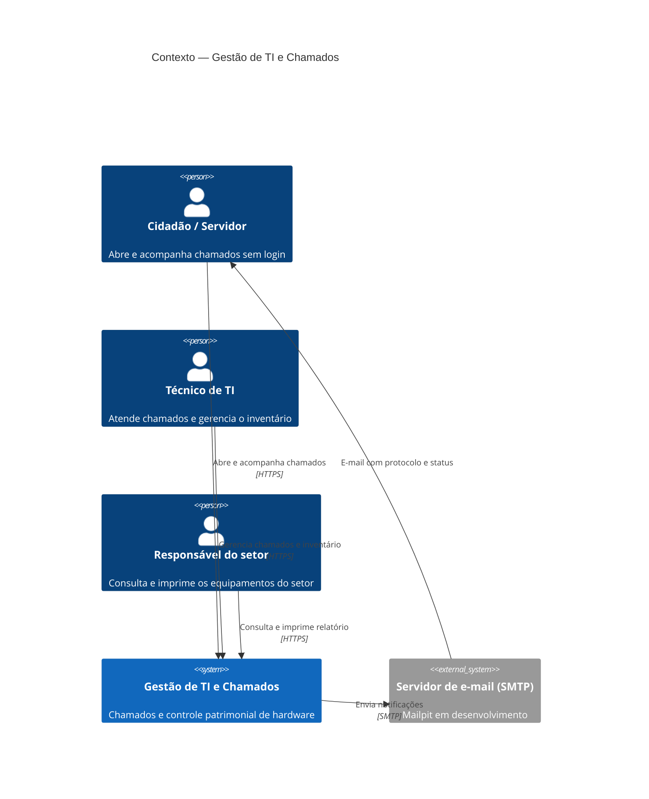
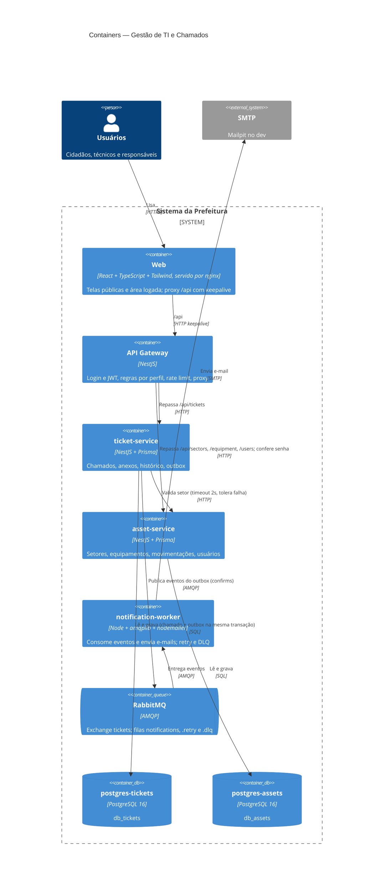

# Gestão de TI e Chamados — Prefeitura Municipal de Jacaraú

Sistema distribuído para o Setor de TI da Prefeitura: o **cidadão ou servidor abre chamados de suporte sem login**, os **técnicos** atendem a fila e controlam o **inventário de equipamentos** por setor, e o **responsável de cada setor** consulta e imprime a relação de equipamentos sob sua guarda. Substitui a planilha de patrimônio e o atendimento informal.

Projeto final de Engenharia de Sistemas Distribuídos 2026.1 (UFPB, Centro de Informática).

> **Videocast:** _adicionar o link (YouTube não listado ou Google Drive)_

## Funcionalidades

| Quem | O quê |
|---|---|
| Cidadão / servidor (sem login) | abre chamado com fotos, PDF ou vídeo; recebe o protocolo `JAC-XXXX-XXXX` e e-mails a cada mudança; acompanha o status pelo protocolo |
| Técnico de TI | fila por status e prioridade; assume, responde (público ou nota interna), muda status; CRUD de setores, locais e equipamentos; histórico de movimentação; cadastro de usuários |
| Responsável do setor | vê só os equipamentos do próprio setor e locais vinculados; imprime o relatório com campos de assinatura |

## Arquitetura

### C4 — Nível 1: contexto



### C4 — Nível 2: containers



### Padrões aplicados

| Padrão | Onde | ADR |
|---|---|---|
| Microsserviços | 3 serviços + gateway, monorepo Nest | [0001](docs/adr/0001-microsservicos.md) |
| Database-per-service | 2 PostgreSQL, sem FK entre serviços | [0002](docs/adr/0002-database-per-service.md) |
| API Gateway + Rate Limit | `apps/backend/apps/gateway` | [0003](docs/adr/0003-api-gateway.md) |
| Transactional Outbox + EDA | `ticket-service/src/outbox.ts` | [0004](docs/adr/0004-outbox-rabbitmq.md) |
| Retry + DLQ | filas `notifications.retry` e `.dlq` | [0004](docs/adr/0004-outbox-rabbitmq.md) |
| Bulkhead / isolamento de falhas | chamado abre com o inventário fora; gateway responde 503 | [0001](docs/adr/0001-microsservicos.md) |

Áreas cobertas: **segurança** (JWT, perfis, rate limit, cabeçalhos forjados descartados, protocolo não enumerável, segredos em `.env`), **confiabilidade** (outbox, retry, DLQ, isolamento), **desempenho** (teste de carga, keepalive) e **deployment** (Docker Compose, CI).

Outras decisões: [stack TypeScript (0005)](docs/adr/0005-stack-typescript.md), [privacidade do chamado público (0006)](docs/adr/0006-privacidade-chamado-publico.md), [escopo do responsável (0007)](docs/adr/0007-escopo-responsavel.md).

### Trade-offs principais

- **Consistência eventual entre serviços:** o nome do setor é copiado no chamado e não muda se o setor for renomeado (ADR 0002).
- **E-mail pelo menos uma vez:** em caso raro de queda entre o confirm e o update do outbox, o e-mail pode sair duplicado (ADR 0004).
- **Instância única:** o rate limit fica em memória e o publisher do outbox não usa `SKIP LOCKED`. Escalar o gateway ou o ticket-service exige Redis e `SKIP LOCKED` (ADRs 0003 e 0004).
- **Usuários no asset-service** em vez de um serviço de autenticação próprio (ADR 0007).
- **Relatório por `@media print`** em vez de geração de PDF no servidor.

## Como executar

Requisitos: Docker com Compose v2. Node 22 só para desenvolvimento fora do Docker.

```bash
cp .env.example .env          # troque as senhas
docker compose up -d --build --wait
```

| Endereço | O quê |
|---|---|
| http://localhost:8080 | sistema (login com `ADMIN_EMAIL` / `ADMIN_PASSWORD` do `.env`) |
| http://localhost:8080/abrir-chamado | formulário público |
| http://localhost:8025 | Mailpit: e-mails enviados |
| http://localhost:15672 | painel do RabbitMQ (usuário e senha do `.env`) |

O banco começa com os setores e equipamentos de exemplo do protótipo. Para zerar tudo: `docker compose down -v`.

### Desenvolvimento

```bash
docker compose up -d postgres-assets postgres-tickets rabbitmq mailpit
cd apps/backend && npm install && npm run start:dev   # ver nest-cli.json para cada app
cd apps/web && npm install && npm run dev             # Vite com proxy /api → :3000
```

### Estrutura

```
apps/backend/          monorepo Nest
  apps/gateway/          login, JWT, perfis, rate limit, proxy
  apps/ticket-service/   chamados, anexos, outbox      (prisma/)
  apps/asset-service/    setores, equipamentos, usuários (prisma/)
  apps/notification-worker/  consumidor RabbitMQ → e-mail
  libs/common/           healthcheck e topologia AMQP compartilhada
apps/web/              React + Vite + Tailwind (design "Contraste editorial")
scripts/               testes de integração e resiliência
load/k6.js             teste de carga
docs/adr/              decisões de arquitetura
docs/testes.md         plano e resultados de testes
```

## Testes

Plano completo e resultados medidos em **[docs/testes.md](docs/testes.md)**. Resumo: 8 testes unitários, 46 verificações de integração e resiliência (também no CI) e teste de carga com **1.530 req/s, 0% de falhas e p95 abaixo de 60 ms**. A primeira rodada de carga revelou o esgotamento de portas no nginx (61% de 502), corrigido com keepalive.

CI (GitHub Actions): checagem de tipos, testes unitários e build do back e do front; depois sobe o Compose inteiro e roda os scripts de integração e resiliência.

## Equipe e responsabilidades

| Integrante | Responsabilidade |
|---|---|
| _preencher_ | Infraestrutura / DevOps: Docker Compose, CI, gateway |
| _preencher_ | ticket-service: abertura pública e anexos |
| _preencher_ | Painel dos técnicos e notificações (outbox, worker) |
| _preencher_ | asset-service: inventário, movimentações, escopo do responsável |
| _preencher_ | Front-end do inventário, relatórios, testes e documentação |

## Ferramentas de IA utilizadas

> Seção obrigatória (enunciado, seção 5). **A equipe deve revisar e completar com as ferramentas que cada integrante usou.**

**Claude Code (modelo Claude Opus 5.5, Anthropic)**

- **Onde atuou:** proposta das direções visuais e redesenho do front; plano de refatoração (`docs/PLANO-REFATORACAO.md`); geração do código das etapas 1 a 8 (monorepo Nest, Prisma, gateway, outbox, worker, telas React); scripts de teste; ADRs, `docs/testes.md` e este README.
- **Como foi orientado:**
  - Recebeu os PDFs do enunciado e do Projeto 02 como fonte de requisitos e as tecnologias definidas pela equipe (React, TypeScript, Tailwind, Nest, PostgreSQL, Prisma, Docker).
  - Usou skills de design (Impeccable e taste-skill) para melhorar o visual do Front-end. A direção "Contraste editorial" foi escolhida entre seis propostas.
  - Usou a skill "ponytail", que pede a solução mais simples que funciona e evita dependências e abstrações desnecessárias.
  - Trabalhou em etapas, cada uma testada no Docker e aprovada antes da próxima.
- **O que funcionou:** a estrutura dos serviços, o outbox e o retry com DLQ funcionaram de primeira nos testes de resiliência. Os testes de integração pegaram regressões entre as etapas.
- **O que precisou ser corrigido** (encontrado pela própria IA ao testar, antes do commit, salvo indicação):
  - rota de healthcheck fora do prefixo `/api`;
  - campo do formulário invadindo a coluna vizinha;
  - relatório espremido na impressão pelo grid do menu;
  - `pattern` do campo WhatsApp inválido nos navegadores atuais (este foi commitado e corrigido no commit seguinte);
  - teste unitário que passava a query string para a regra de acesso;
  - scripts de teste quebrando com acentos no `curl` do Windows;
  - esgotamento de portas no nginx sob carga, achado pelo k6.
- **O que foi descartado:**
  - cinco direções visuais não escolhidas, incluindo uma aplicada no protótipo e depois guardada em `git stash`;
  - uso da taste-skill no modo "landing page", que não se aplica a um sistema interno;
  - transporte de microsserviços do Nest, substituído por `amqplib` para controlar o retry;
  - um serviço de autenticação separado (ADR 0007).
- **Avaliação:** acelerou muito a parte repetitiva (CRUD, DTOs, telas). As decisões de arquitetura foram definidas e aprovadas  pelos integrantes do projeto. Todo o código foi testado no ambiente real antes de entrar no repositório.